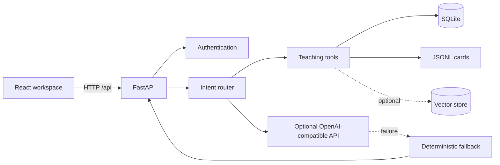

# Architecture

CodeCoach is a monorepo with a React frontend and a FastAPI backend. The backend owns authentication, orchestration, persistence, retrieval, and optional LLM access. Browser code never receives provider secrets.

## Request Flow

1. The frontend sends a typed request to `/api/chat` with an authenticated user token.
2. The intent router selects knowledge QA, problem understanding, hinting, code debugging, data QA, or review.
3. The orchestrator calls local tools for code rules, knowledge retrieval, learning statistics, sessions, and review memories.
4. If configured, specialized Agent prompts can refine the response through an OpenAI-compatible API.
5. Any unavailable external service falls back to deterministic local rendering.
6. The response includes the answer, next actions, review data, similar memories, and an Agent trace.

## Persistence

- SQLite stores users, sessions, turns, memories, review state, and statistics.
- JSONL files under `data/knowledge_seed/` are the versioned source of truth for teaching cards.
- The vector-store adapter is optional. The default install uses JSONL retrieval because the current ChromaDB release has an unresolved security advisory.
- Runtime data is stored under `data/runtime/` locally or `/app/data` in the container.

## Trust Boundaries

- LLM credentials are backend-only environment variables.
- Frontend `VITE_*` variables are public and must never contain secrets.
- User prompts, source code, traces, and learning records can be sensitive.
- The lightweight C analyzer inspects text only; it does not compile or execute submitted C code.

## Production Gaps

The repository is designed as an educational Beta. A public production service should add rate limiting, account recovery, abuse prevention, session-token hardening, observability, backup testing, and a deployment-specific privacy policy.
